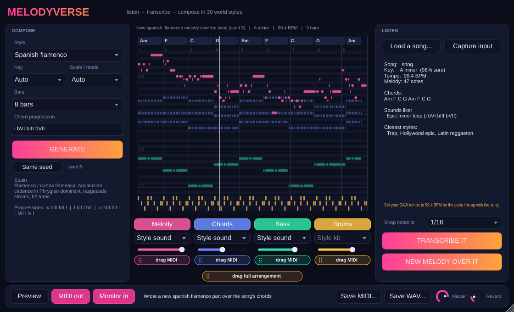

# Melodyverse

**Listen to any track → get its melody and chords back as MIDI + audio → write brand-new melodies in the musical language of Hollywood, Spain, Punjab, Bollywood, Latin America, the UK/US charts and more.**

Available as a **VST3 / AU / standalone plugin** ([below](#the-vst3-plugin)) and as a Python package + command-line tool.

```
melodyverse transcribe song.mp3          # the song's melody & chords → .mid + .wav
melodyverse match song.mp3 -s punjabi    # NEW bhangra melodies over the song's own chords
melodyverse generate -s hollywood        # an original epic film cue from scratch
```

---

## What it does

| Command | What you get |
|---|---|
| `analyze`     | Tempo, key **and mode** (major, minor, Mixolydian/Khamaj, Phrygian-dominant…), chord chart with roman numerals, famous progressions it uses, closest world styles, melody notes |
| `transcribe`  | The track's **melody** and **chords** as MIDI (full + one file per part), the same parts re-played as WAV, and a JSON report. MIDI is time-aligned with the original song, so drop it at bar 1 in your DAW |
| `match`       | Several **new, original melodies** in any style, written over the track's own chords, key and tempo, plus an optional mix of each new melody over the original song (`--mix`) |
| `generate`    | A complete original idea (melody + chords + bass + drums) in any of 30 styles, as MIDI and WAV, with one stem per part |
| `render`      | Any MIDI file → WAV with the built-in synthesizer |
| `styles` / `progressions` | Browse the style library and 21 famous progressions (spelled in any key) |

Everything runs locally. Audio is produced by a built-in synthesizer (piano, strings, brass, flute, bansuri, sitar, tumbi, harmonium, nylon guitar, oud, 808, supersaw, drums, dhol, tabla, cajón, darbuka…), so no SoundFonts or DAW are needed to hear results.

## Install

```bash
pip install -e .                 # core: numpy, scipy, librosa, soundfile, mido
pip install -e ".[separation]"   # optional: Demucs vocal isolation (--separate)
pip install -e ".[polyphonic]"   # optional: Spotify Basic Pitch (--engine basic-pitch)
```

Python 3.10+. MP3/M4A decoding uses ffmpeg if it is installed.

## Quick start

```bash
# 1. What's in this song?
melodyverse analyze song.mp3 --json song.json

# 2. Give me the melody & chords back (MIDI + audio), snapped to 1/16 notes
melodyverse transcribe song.mp3 --quantize 16 -o out/
#    out/song.mid  song_melody.mid  song_chords.mid  song_bass.mid
#    out/song.wav  song_melody.wav  song_chords.wav  song_bass.wav  song_analysis.json

#    Cleaner melody from a busy mix: isolate the vocal first
melodyverse transcribe song.mp3 --separate -o out/          # needs demucs
melodyverse transcribe song.mp3 --vocals vocals.wav -o out/ # or bring your own stem

# 3. Write 5 new melodies over the song's chords, in Punjabi style, mixed over the original
melodyverse match song.mp3 -s punjabi -n 5 --mix -o ideas/

# 4. Compose from scratch
melodyverse generate -s hollywood_epic --key "D minor" --bpm 84 --bars 16 -n 3
melodyverse generate -s spanish_flamenco                     # Andalusian cadence, E Phrygian dominant
melodyverse generate -s bollywood --progression "I vi IV V"  # your own progression (roman or chord names)
melodyverse generate -s english_pop --progression "Am F C G" --instrument piano
```

## The style library (30 styles)

`melodyverse styles -v` lists them all with progressions, ornaments and instruments. Aliases work too: `hollywood`, `spanish`, `latin`, `punjabi`, `bhangra`, `bollywood`, `english`, `pop`, `edm`, `rap`, `jazz`, `afro`, `arabic`, `anime`…

| Region | Styles |
|---|---|
| Hollywood / film | `hollywood_epic`, `hollywood_heroic`, `hollywood_wonder` (Lydian fantasy), `cinematic_suspense`, `film_emotional` |
| Spain & Latin America | `spanish_flamenco`, `latin_reggaeton`, `latin_bachata`, `bossa_nova` |
| Punjab & India | `punjabi_bhangra` (dhol chaal, tumbi, Khamaj), `punjabi_sad` (Kafi, meend), `bollywood_romantic`, `indian_classical` (Bhairav) |
| English-language | `english_pop`, `pop_ballad`, `rock`, `edm_house`, `trap`, `rnb_soul`, `lofi`, `gospel`, `country`, `blues`, `jazz_swing` |
| Rest of the world | `afrobeats`, `reggae`, `arabic_hijaz`, `celtic`, `japanese_anime`, `baroque` |

Each style encodes its **scale/raga/maqam**, stock **progressions**, melodic **rhythm cells**, **phrase form** (AABA, ABAC…), **contour**, interval preferences, comping & bass patterns, a **drum groove**, swing, instruments, and **ornaments**: `murki` (quick Punjabi/Hindustani turns), `meend` (glides, exported as MIDI pitch-bend), `flamenco_turn`, `trill`, and bent `blue_note`s.

28 scales are built in, including Hindustani thaats (Bilawal, Kalyan, Khamaj, Kafi, Asavari, Bhairavi, Bhairav, Todi, Purvi, Marwa), Phrygian dominant (Spanish/Hijaz), double harmonic, Hungarian minor, the blues scale and pentatonics.

## How it listens

1. **Tempo & beats**: onset-strength beat tracking (librosa).
2. **Chords**: beat-synchronous chroma, split into a treble band that sets the chord *quality* and a bass band that *votes for the root*. Frames are matched to maj/min/7/m7/dim/sus4 templates and smoothed with a Viterbi pass.
3. **Key & mode**: the pitch-class profile plus harmonic evidence (which tonic chord sounds longest, how the song opens, cadences into the tonic such as V→I, bVII→I and bII→I). That is how it tells C major from A minor from G Mixolydian, and E Phrygian-dominant flamenco from A minor.
4. **Melody**: on a full mix, a harmonic-sum salience map on a constant-Q spectrogram picks the predominant (top) voice, smoothed with a Viterbi pitch-continuity model. On an isolated stem it uses pYIN. Both are then segmented into notes, with tuning correction, onset-based re-articulation and loudness→velocity.
5. **Labelling**: roman numerals, famous-progression spotting, and a ranking of which library styles share the harmony.

On the synthetic test songs in `tests/` (known ground truth), it recovers tempo within ~1%, the exact key and mode, the chord roots, and about 85–90% of the melody's notes at the right pitch.

## Honest limits

- **It does not contain "every melody ever made"**, and it shouldn't. Recorded melodies are copyrighted, and no such database exists. What it carries is the *grammar* of each tradition: scales, progressions (not copyrightable), rhythms and ornaments. With those it writes *new* melodies that sound native to the style. `transcribe` extracts the melody of a track **you** give it; make sure you have the rights to whatever you release.
- Melody transcription from a dense commercial mix is a hard research problem. Expect a strong starting point that needs some cleanup in the piano roll, not a perfect score. `--separate` (Demucs) or `--vocals` improves results a lot. Bell-like, very breathy or heavily auto-tuned leads are hardest.
- The chord vocabulary is maj, min, 7, m7, dim and sus4. Extended jazz harmony is reported as its core triad or seventh chord.
- Fixed 4/4 grid and a single tempo per track.

## The VST3 plugin

`plugin/` contains **Melodyverse as a VST3 plugin** (plus an AU on macOS and a standalone app). It is a native C++ port of this engine, so no Python is needed inside your DAW.



- **Compose:** pick one of the 30 styles, a key/mode, bar count or your own progression, then hit **GENERATE**. Melody, chords, bass and drums play **in sync with your DAW transport**, at the project tempo, looping.
- **Listen:** drop a song on the plugin (WAV, AIFF, FLAC, OGG, MP3), or press **Capture input** and play audio into it. That can be a sidechain or input routing in your DAW, or your mic in the standalone app, so you can even hum a tune. It detects key, mode, tempo, chords and melody, names the famous progression it uses, and suggests the closest styles.
  - **TRANSCRIBE IT:** the song's own melody, chords and bass become a playable, draggable MIDI arrangement.
  - **NEW MELODY OVER IT:** an original part in the selected style, written over the song's chords, key and tempo.
- **Vocals tab:** drop in a vocal (an a cappella or isolated vocal stem), or record one. Melodyverse studies it in depth with a Hindustani/Punjabi lens:
  - **Scale:** Sa (tonic), thaat (Bilawal, Khamaj, Kafi, Asavari, Bhairavi …, plus the Western mode) and every swara used, komal and tivra included.
  - **Voice:** range, comfortable zone and voice type.
  - **Ornaments:** **meend** glides, **murki**, **kan swar**, and **vibrato** rate and depth.
  - **Accuracy:** pitch accuracy in cents and tuning reference.
  - **Shape:** phrases, breaths and contour, the repeating **hook**, tempo, swing and dynamics.
  - **Chords:** it then ranks the **top 5 chord progressions** that fit the singing bar by bar. One is tailor-made; the rest come from Punjabi sad (Kafi), bhangra (Khamaj), Punjabi pop, Punjabi R&B, Sufi, lo-fi and cinematic loops.
  - **Arrangement:** click one to hear a full arrangement under the vocal guide, with **answer phrases** between your lines or a **harmony** a 3rd above or 6th below.
- **Get the notes out:** drag any part (or the full arrangement) from its **drag MIDI** pill straight into your timeline. You can also enable **MIDI out** (melody ch.1, chords ch.2, bass ch.3, drums ch.10) to drive your own instruments, or use **Save MIDI / Save WAV**.
- Per-part on/off, volume and instrument (the vocal guide is its own part, MIDI ch.4) (piano, strings, brass, flute, bansuri, sitar, tumbi, harmonium, nylon guitar, oud, 808, supersaw…). Everything is saved with your project.

### Download

Every push builds the plugin for **Windows, macOS (Universal) and Linux** on GitHub Actions. The builds are validated with [pluginval](https://github.com/Tracktion/pluginval) at strictness 10 and run the full test suites. Grab the zip from the workflow run's *Artifacts*. When a version tag (`v*`) is pushed, the zips are attached to the GitHub Release.

| OS | Copy `Melodyverse.vst3` to |
|---|---|
| Windows | `C:\Program Files\Common Files\VST3\` |
| macOS | `~/Library/Audio/Plug-Ins/VST3/` (and `Melodyverse.component` to `~/Library/Audio/Plug-Ins/Components/` for Logic/GarageBand) |
| Linux | `~/.vst3/` |

The macOS build is ad-hoc signed, not notarized. If macOS blocks it, run `xattr -cr ~/Library/Audio/Plug-Ins/VST3/Melodyverse.vst3`.

### Using it in a DAW

1. Insert **Melodyverse** as an **instrument** on an instrument/MIDI track and press play: you hear the pattern in sync.
2. To have it listen to another track, route that track into Melodyverse's input (sidechain or input routing; "Monitor in" passes it through), arm **Capture input**, play the section, then press **Stop**. It uses your project tempo for the analysis. Dropping an audio file onto the plugin works in every DAW.
3. Drag the parts you like into the timeline. Transcriptions are aligned to the start of the song; set the project tempo to the BPM shown in the plugin.

MIDI output from VST3 instruments is supported in Reaper, Cubase, Bitwig and Studio One, among others. In DAWs that don't route plugin MIDI out (e.g. Ableton Live), use drag-and-drop.

### Build from source

```bash
cmake -S plugin -B build -DCMAKE_BUILD_TYPE=Release        # downloads JUCE 8.0.4 (or pass -DJUCE_DIR=/path/to/JUCE)
cmake --build build --config Release --target Melodyverse_All core_tests plugin_tests
ctest --test-dir build -C Release                          # core engine tests
build/plugin_tests_artefacts/Release/plugin_tests          # plugin integration tests (use xvfb-run on headless Linux)
```

Linux needs: `libasound2-dev libx11-dev libxrandr-dev libxinerama-dev libxcursor-dev libxext-dev libfreetype-dev libfontconfig1-dev libgl1-mesa-dev`.

**Layout:** `plugin/core/` is the dependency-free C++17 engine (theory, styles, generator, analyser, real-time synth, MIDI writer), unit-tested on its own. `plugin/source/` is the JUCE processor and UI. The style library lives in Python and is exported to `plugin/core/StylesData.inc` with `python tools/export_styles_cpp.py`; a test fails if the two drift apart.

## Use the CLI's output in your DAW

Every result is a standard General-MIDI file with tempo, key signature and chord-name markers. Drag `*_melody.mid` / `*_chords.mid` onto your own instruments. Transcriptions are aligned to the start of the original audio.

## Python API

```python
from melodyverse import generate
from melodyverse.analysis import analyze, analysis_to_score
from melodyverse.midi_io import write_midi
from melodyverse.synth import render, write_wav

an = analyze("song.mp3")                                  # tempo, key, chords, melody
print(an.key.name(), an.bpm, an.romans[:8])
score = analysis_to_score(an, quantize=16)
write_midi(score, "song_transcribed.mid")

idea = generate("punjabi_bhangra", key="C khamaj", bars=8, seed=7)
write_midi(idea, "bhangra.mid"); write_wav("bhangra.wav", render(idea))
```

## Development

```bash
pip install -e ".[dev]"
pytest            # 60 tests, ~15 s: theory, every style, MIDI/audio I/O, end-to-end listening
```
